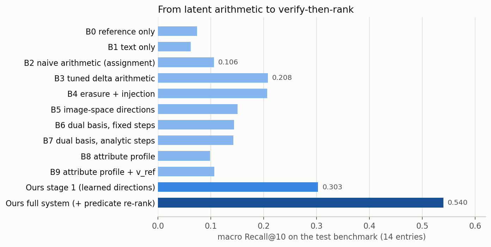
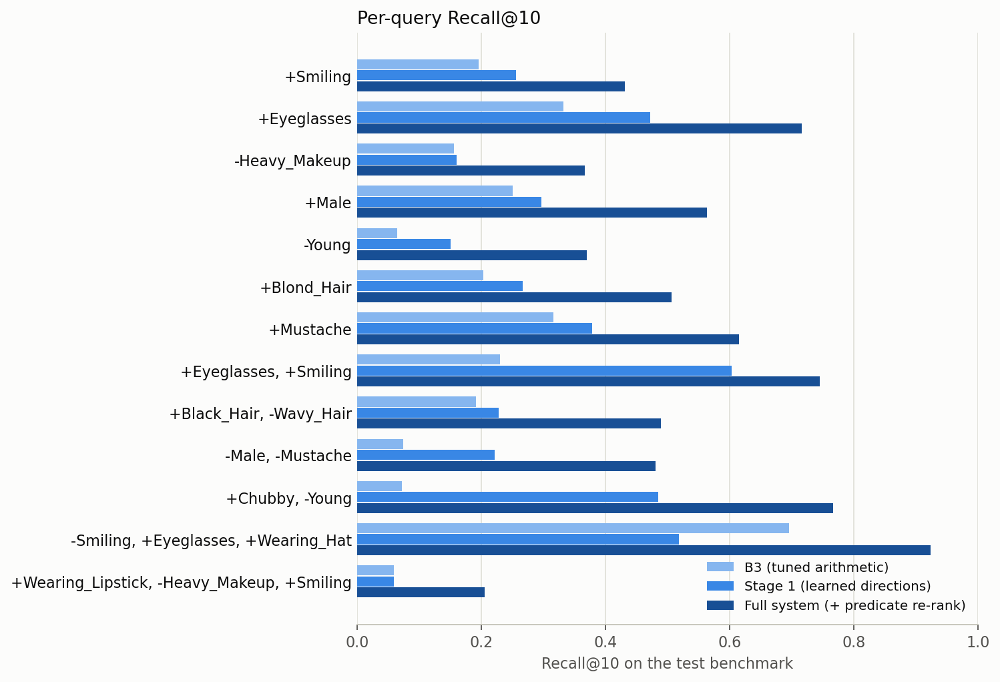
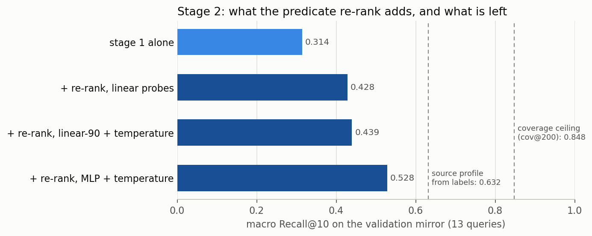
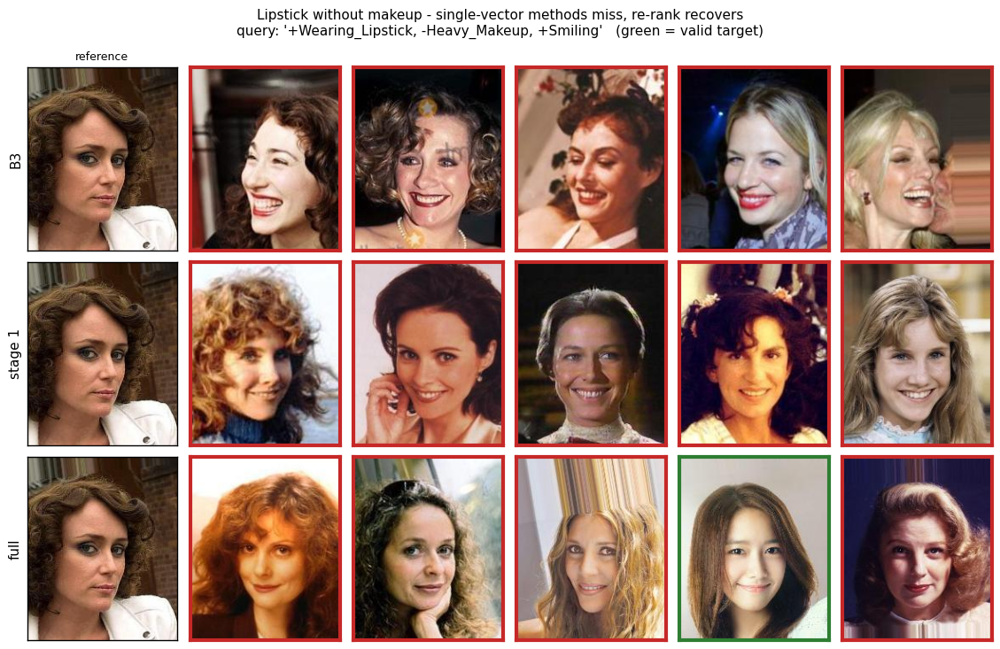

# Compose, then Verify

**Two-stage compositional image retrieval on CelebA with a frozen CLIP ViT-B/32.**
A learned set of signed attribute directions composes the query and retrieves
candidates; a probabilistic re-ranker then checks each candidate against the
full relevance rule of the benchmark.

[](requirements.txt)
[](requirements.txt)
[-412991)](https://huggingface.co/openai/clip-vit-base-patch32)
[](https://mmlab.ie.cuhk.edu.hk/projects/CelebA.html)
[](notebooks/report.ipynb)
[](LICENSE)

On the official 14-entry test benchmark, macro Recall@10 goes from **0.106**
with the latent arithmetic prescribed by the assignment to **0.540** with the
full system.

---

## The problem

**Compositional image retrieval with signed attribute edits.** The input is a
reference face $v_{ref}$ plus a short list of edits, each an attribute with a
sign: `+Eyeglasses`, `-Smiling`, or combinations such as
`-Smiling, +Eyeglasses, +Wearing_Hat`. The system ranks the 19,962 images of
the CelebA test split. A good result is a *different* photo that has every `+`
attribute, lacks every `-` attribute, and otherwise looks like the reference.

The assignment asks for a fusion module $\Phi(v_{ref}, \mathcal{T}^+, \mathcal{T}^-)$
on top of a frozen vision-language backbone. Its stated motivation is a
limitation of CLAY (Lim et al., 2026), which combines several conditions by
stacking them before an SVD, with no way to weight or reconcile them.

The benchmark makes "looks like the reference" precise. A target is valid when
it satisfies **all** queried constraints **and** differs from the reference on
**at most 2** of the remaining attributes. A query source is admitted only if
it violates every constraint of its query and has at least 5 valid targets.
That rule, the conjunction of constraints plus a Hamming budget on everything
else, drives most of the design decisions below.

### Setting and constraints

| Aspect | Detail |
|---|---|
| Backbone | CLIP ViT-B/32 (`openai/clip-vit-base-patch32`), frozen. Projected 512-d image features of all 202,599 CelebA images, extracted once and cached |
| Data | CelebA official splits: 162,770 train / 19,867 validation / 19,962 test images, 40 binary attributes |
| Retrieval database | the 19,962 test images (the source image is excluded from its own ranking) |
| Benchmark | `celeba_evaluation.json` (course-provided): 14 entries, 13 unique queries (`-Young` appears twice), 1 to 3 signed attributes per query, 33,052 (source, query) pairs |
| Ground truth | rebuilt from the raw annotations and asserted identical to the JSON for all 14 entries (sources and target lists) |
| Metrics | Recall@K and Precision@K for K ∈ {1, 5, 10}, computed with the course's `evaluate_retrieval`; averaged over the sources of each entry, then macro-averaged over the 14 entries. Headline metric: macro R@10 |
| Model selection | a *validation mirror*: the same benchmark rule applied to the validation split (13 queries). The test set is used only for two declared runs with every choice frozen. Fixed step budgets, no early stopping, seed 0 |

---

## The approach

Each step below was added because the previous one hit a limit that we could
measure.

### 1. A pipeline that cannot be silently wrong

We first parse the raw CelebA annotations, rebuild the benchmark ground truth
from its definition, and assert exact equality with the provided JSON. Doing so
pinned down two details that every later method depends on: indices refer to
the test split in filename order, and every source violates *all* constraints
of its query. A batched GPU evaluation harness is asserted equal to the course's
`evaluate_retrieval` before it is used.

### 2. Training-free ladder (B0–B9)

We give each attribute a zero-shot direction $d_a$ in CLIP space, picking per
attribute between three prompt constructions: the raw positive prompt, a
difference against an explicit antonym (*clean-shaven* rather than *no
mustache*), or a difference against a neutral *"a photo of a person"*. The
choice is made by validation AUC; the mean over the 12 benchmark attributes is
0.864, with `Chubby` the weakest at 0.602. On top of these directions we
measure ten composition rules. They range from the reference alone (B0) and
the assignment's naive arithmetic (B2) to tuned asymmetric delta arithmetic
$q = v_{ref} + \alpha\sum_{+} d_a - \beta\sum_{-} d_a$ (B3), plus four
refinements, each tied to a hypothesis:

- **H1, per-query weighting:** a per-query oracle over the whole $(\alpha, \beta)$ grid;
- **H2, erasing the queried subspace from $v_{ref}$:** B4;
- **H3, more separable image-space directions:** B5;
- **H4, matching the attribute profile through probes:** B6–B9.

B3 wins and none of the four hypotheses helps (see [Results](#results)).
**Limit:** the edit steps are hand-scaled zero-shot text directions, and
nothing in them is supervised by the retrieval criterion.

### 3. Stage 1: learned signed directions (DirectionFusion)

The fusion module keeps B3's form but learns the steps. It has one direction
per (attribute, sign), $E \in \mathbb{R}^{2 \times 40 \times 512}$
(40,960 parameters), and

$$\Phi(v_{ref}, \mathcal{Q}) = \mathrm{normalize}\Big(v_{ref} + \sum_k e_{s_k, a_k}\Big).$$

At initialization it equals B3 exactly. It is trained with InfoNCE on synthetic
queries drawn from the **train** split with the benchmark's own rule. The
negative bank mixes three kinds of images:
- targets of the same query, which carry the identity signal;
- targets of other queries, which carry the condition signal;
- the batch sources, which are hard negatives: identity-similar, with every condition violated.

The learning rate is chosen on the mirror. We also train a
reference-conditioned gate on top of the directions; it shows no reliable gain
(see [Key findings](#key-findings)).
**Limit:** stage 1 still ranks by one dot product, and a dot product cannot
express "all of these constraints *and* at most two other differences".

### 4. Diagnosis: which half of the relevance rule is missing

Before adding machinery we score the stage-1 ranking on the mirror with label
oracles. Valid targets are usually already there: the macro share of sources
with a valid target inside the top-200 is 0.848 (`cov@200`). Moving every
candidate that satisfies the queried constraints to the front (oracle `o-sat`)
only reaches 0.396, against 0.314 for stage 1. Most of the gap is therefore in
the *preservation* half of the rule:
the Hamming budget on the ~37 unqueried attributes, which no method so far had
scored.

### 5. Stage 2: re-ranking with the full predicate

For each candidate $x$ in stage 1's top-200 we score the benchmark rule
directly, from per-attribute posteriors $p_a(x)$:

$$S(x) = \sum_{(a,s) \in \mathcal{Q}} \log P\big(\mathrm{attr}_a(x) = s\big) + \log P\Big(\sum_{a \notin \mathcal{Q}} \mathbb{1}\big[\mathrm{attr}_a(x) \neq \mathrm{attr}_a(v_{ref})\big] \le 2\Big) + \varepsilon \cos(q, x)$$

The second term is the tail of a Poisson-binomial distribution. Per-attribute
disagreements are treated as independent Bernoulli events, with the reference's
own attributes read by the same probes, and the tail is computed exactly with a
small dynamic program. $\varepsilon = 10^{-4}$ only breaks ties. A
near-uninformative probe contributes an almost constant factor, so weak probes
cost little. The probes are trained on the train split only and improved one
change at a time, with a +0.010 adoption threshold on the mirror:
1. linear logistic probes;
2. the same probes with per-attribute temperature scaling on a held-out 10%;
3. small MLP probes (512→64→1) with temperature scaling.

### Appendix: sparse-autoencoder check

The report notebook ends with a TopK sparse autoencoder (1,024 latents, 32
active) trained on the cached train features. It tests two things: whether the
attributes have dedicated latents, and whether image-space directions activate
more unrelated concepts than text directions.

---

## Results

Unless stated otherwise, all numbers come from the final end-to-end run of
[`notebooks/report.ipynb`](notebooks/report.ipynb) (Kaggle GPU, August 10,
2026). [`src/extract_report_results.py`](src/extract_report_results.py) copies
them unchanged into the CSV files of
[`output/results/report/`](output/results/report).



### Test benchmark, all methods

Macro average over the 14 entries
([`test_methods.csv`](output/results/report/test_methods.csv)):

| Method | R@1 | R@5 | R@10 | P@10 |
|---|---|---|---|---|
| B0 reference only | 0.019 | 0.051 | 0.074 | 0.011 |
| B1 text only | 0.017 | 0.041 | 0.062 | 0.007 |
| B2 naive arithmetic (assignment baseline) | 0.022 | 0.071 | 0.106 | 0.014 |
| B3 tuned delta arithmetic | 0.050 | 0.145 | 0.208 | 0.031 |
| B4 erasure + injection | 0.049 | 0.146 | 0.207 | 0.031 |
| B5 image-space directions | 0.030 | 0.103 | 0.151 | 0.021 |
| B6 dual basis, fixed steps | 0.029 | 0.093 | 0.144 | 0.020 |
| B7 dual basis, analytic steps | 0.035 | 0.094 | 0.143 | 0.019 |
| B8 attribute profile | 0.018 | 0.061 | 0.099 | 0.013 |
| B9 attribute profile + $v_{ref}$ | 0.019 | 0.065 | 0.107 | 0.014 |
| Stage 1: learned directions | 0.072 | 0.200 | 0.303 | 0.047 |
| **Full system: stage 1 + predicate re-rank** | **0.156** | **0.405** | **0.540** | **0.107** |

The test set was used for exactly two declared comparisons. Each reports a
stratified bootstrap over sources (1,000 replicates)
([`test_declared_runs.csv`](output/results/report/test_declared_runs.csv)):

| Declared run | Δ macro R@10 | 95% CI |
|---|---|---|
| Stage 1 vs B3 | +0.096 | [+0.076, +0.115] |
| Full system vs stage 1 | +0.236 | [+0.212, +0.259] |

### Per query



Test R@10 per query, best in bold. The benchmark lists `-Young` twice, so it
counts twice in the macro averages above
([`test_per_query.csv`](output/results/report/test_per_query.csv),
[`test_n_sources.csv`](output/results/report/test_n_sources.csv)):

| Query | Sources | B3 | Stage 1 | Full system |
|---|---|---|---|---|
| `+Smiling` | 4786 | 0.196 | 0.256 | **0.431** |
| `+Eyeglasses` | 2196 | 0.333 | 0.472 | **0.716** |
| `-Heavy_Makeup` | 4087 | 0.156 | 0.160 | **0.367** |
| `+Male` | 1595 | 0.251 | 0.297 | **0.564** |
| `-Young` | 5355 | 0.065 | 0.151 | **0.370** |
| `+Blond_Hair` | 5469 | 0.203 | 0.267 | **0.507** |
| `+Mustache` | 301 | 0.316 | 0.379 | **0.615** |
| `+Eyeglasses, +Smiling` | 612 | 0.230 | 0.603 | **0.745** |
| `+Black_Hair, -Wavy_Hair` | 2572 | 0.192 | 0.228 | **0.489** |
| `-Male, -Mustache` | 27 | 0.074 | 0.222 | **0.481** |
| `+Chubby, -Young` | 584 | 0.072 | 0.485 | **0.767** |
| `-Smiling, +Eyeglasses, +Wearing_Hat` | 79 | 0.696 | 0.519 | **0.924** |
| `+Wearing_Lipstick, -Heavy_Makeup, +Smiling` | 34 | 0.059 | 0.059 | **0.206** |

### Stage 2 on the validation mirror



Mirror macro R@10 over the 13 queries
([`mirror_stage2.csv`](output/results/report/mirror_stage2.csv)):

| Variant | Mirror R@10 |
|---|---|
| Stage 1 alone | 0.314 |
| + re-rank, linear probes | 0.428 |
| + re-rank, linear probes + temperature | 0.439 |
| **+ re-rank, MLP probes + temperature (adopted)** | **0.528** |
| Constraint term only | 0.142 |
| Preservation term only | 0.421 |
| Joint score with M = 100 / 200 / 500 candidates | 0.501 / 0.528 / 0.556 |
| *Diagnostic: source profile from true labels* | *0.632* |
| *Ceiling: coverage of the top-200 (`cov@200`)* | *0.848* |

The pool size M = 200 was fixed before the test run, at the diagnosis stage,
and was not tuned on the mirror curve.

### A qualitative example



`+Wearing_Lipstick, -Heavy_Makeup, +Smiling` is the hardest query. Each row
shows the top-5 results of B3, stage 1 and the full system for the same
reference (leftmost image). The notebook picks a source where B3 and stage 1
miss and the full system finds a valid target. A green border marks a valid
target, a red border an invalid one.

---

## Key findings

- **Verifying beats composing for the final ranking.** Stage 1 adds +0.096 over
  B3; the re-rank adds +0.236 on top of stage 1. The larger jump comes from the
  half of the rule that a single query vector cannot express. Neither half of
  the predicate works alone: the constraint term alone (0.142) is *worse* than
  stage 1 on the mirror, the preservation term alone gives 0.421, the two
  together 0.528.
- **Probe capacity matters more than calibration.** On the mirror, temperature
  scaling adds +0.011 (0.428 → 0.439) and MLP probes another +0.089
  (0.439 → 0.528).
- **Removing an attribute is not the opposite of adding it.** For the learned
  stage-1 directions, $\cos(e_{-,a}, -e_{+,a})$ ranges from −0.127
  (`Wearing_Lipstick`) to 0.735 (`Eyeglasses`)
  ([`direction_geometry.csv`](output/results/report/direction_geometry.csv)).
  This is also why B3 needs separate $\alpha$ and $\beta$.
- **The lipstick triple is a vector-arithmetic dead end.** B3 and stage 1 both
  score 0.059 on `+Wearing_Lipstick, -Heavy_Makeup, +Smiling`. The re-rank,
  which reads each attribute with its own probe, reaches 0.206.
- **Stage 1 has one real regression.** On the hat triple it falls below B3
  (0.696 → 0.519); the re-rank recovers it to 0.924.
- **Negative: hand-designed training-free refinements do not beat tuned
  arithmetic.**
  - H1: the per-query $(\alpha,\beta)$ oracle reaches 0.222 against 0.205 for
    the global choice on the mirror
    ([`mirror_training_free.csv`](output/results/report/mirror_training_free.csv)).
  - H2: subspace erasure (B4) ties B3 on test (0.207 vs 0.208).
  - H3: image-space directions (B5, test 0.151) separate attributes better
    (validation AUC 0.916 vs 0.864) but retrieve worse.
  - H4: profile matching (B6–B9) stays at or below 0.144 on test.
- **Negative: reference-conditioned gating gives no reliable gain.** In the
  final run the gate scores 0.324 on the mirror against 0.314 for the plain
  directions
  ([`mirror_stage1.csv`](output/results/report/mirror_stage1.csv)). In the
  development run, under the same protocol, the sign was reversed: 0.291 vs
  0.296 ([lab log](documents/lab_log.md)). This fits the benchmark's structure:
  every source violates all of its constraints, so the gate has little
  reference-specific variation to exploit.
- **Negative: the sparse autoencoder is usable but does not isolate the
  attributes.** It passes the reconstruction gate (cosine 0.9722, threshold
  0.90) and, narrowly, the dead-latent gate (0.2939, threshold 0.30). It fails
  concept coverage: only 12 of 40 attributes clear the permutation null
  (25 required). It does support H3: the mean concept-space overlap is 0.363
  for image-space directions against 0.115 for text directions
  ([`sae_summary.csv`](output/results/report/sae_summary.csv)).

### Ideas tested and discarded during development

These experiments were run on the validation mirror during development
(July 2026, local GPU), before the final Kaggle run. They use the development
stage-1 model (mirror R@10 0.296), so their absolute numbers are not directly
comparable with the tables above. The full record is in the
[lab log](documents/lab_log.md), and every number below is in the listed JSON
file.

| Idea | What was tried | Measured (mirror R@10) | Outcome |
|---|---|---|---|
| Half-space veto on negation | learned penalty on candidates that violate a negated attribute | 0.296 → 0.307; all of the gain on `-Male, -Mustache` (0.171 → 0.314) | partial, not adopted ([json](output/results/p1_negation_veto/veto_ablation_mirror.json)) |
| Paired directions | directions from image pairs that differ only in the attribute | training-free B3: 0.203 → 0.257; as stage-1 initialization: 0.298 vs 0.296 | real but absorbed by training ([json](output/results/p2_paired_directions/b3_direction_ablation_mirror.json), [json](output/results/p2_paired_directions/fusion_init_ablation_mirror.json)) |
| Gaussian experts | class-conditional Gaussians instead of linear probes | QDA below the logistic probe on 12/12 benchmark attributes (mean AUC 0.932 vs 0.968) | stopped at diagnosis ([json](output/results/p3_gaussian_experts/gaussian_fit_diagnostic.json)) |
| Rotational composition | rotations instead of additive edits, against the 1/√k dilution of multi-edit queries | dilution confirmed (1.000 / 0.766 / 0.515 for k = 1/2/3 under B3); rotation 0.237 vs addition 0.257 with the same directions | diagnosis true, cure falsified ([json](output/results/p4_rotations/dilution_diagnostic_mirror.json), [json](output/results/p4_rotations/rotation_ablation_mirror.json)) |
| QB-Norm against hubness | subtract gallery popularity estimated from a bank of synthetic queries | monotone loss with γ (0.296 → 0.243); oracle popularity ceiling 0.301 | falsified ([json](output/results/p5_hubness/qbnorm_ablation_mirror.json), [json](output/results/p5_hubness/oracle_popularity_headroom.json)) |
| Constraint-only verification | re-rank the top-M by probe log-likelihoods of the queried constraints | best +0.0004 over 294 grid points; `Heavy_Makeup` probe AUC 0.967 on the whole split but 0.761 inside the lipstick-triple pool | falsified; its autopsy led to stage 2 ([json](output/results/conjunctive_verification/rerank_conjunctive_mirror.json), [json](output/results/conjunctive_verification/probe_hard_forms_mirror.json)) |
| Direction interference | Gram matrix of the paired directions | \|cos\| lipstick–makeup 0.491, male–mustache 0.010 | interference limited to one pair ([json](output/results/direction_interference/gram_diagnostic.json)) |
| Pool-weighted probe training | half of each probe batch drawn from retrieved candidate pools | 0.524 vs 0.523 for plain training | noise, dropped ([json](output/results/mlp_probes/s2_results_mirror.json)) |

---

## Technologies

| Area | Tools |
|---|---|
| Deep learning | PyTorch 2.10, Hugging Face Transformers (CLIP ViT-B/32, frozen) |
| Learned fusion | per-(attribute, sign) direction embeddings, InfoNCE with a learnable temperature and mixed negatives, AdamW, fixed step budgets |
| Probabilistic re-ranking | logistic and MLP attribute probes, per-attribute temperature scaling, exact Poisson-binomial tail by dynamic programming |
| Evaluation and statistics | course `evaluate_retrieval`, batched GPU harness asserted equal to it, label oracles, stratified bootstrap confidence intervals |
| Interpretability | TopK sparse autoencoder, open-vocabulary naming against a permutation null |
| Infrastructure | Jupyter and nbconvert, Kaggle GPU notebook, local RTX 4070 for the development experiments, Matplotlib |

---

## Repository structure

```
notebooks/
├── report.ipynb                  Final report: method, code, outputs of the Kaggle run (Sections 1–15)
└── exploration/
    └── probe_ladder.ipynb        Stage-2 probe ladder on the mirror (development run)
src/
├── paths.py                      Data, feature, checkpoint and output locations (environment variables)
├── extract_report_results.py     Report notebook outputs → output/results/report/*.csv
├── make_figures.py               CSV → output/figures/*.png
├── p1_negation_veto/             Half-space veto (archived, not runnable, see below)
├── p2_paired_directions/         Paired directions; trains the development stage-1 checkpoints
├── p3_gaussian_experts/          Gaussian experts diagnosis
├── p4_rotations/                 Dilution diagnosis and rotational composition
├── p5_hubness/                   Hubness diagnosis, QB-Norm ablation, autopsy and oracle
├── conjunctive_verification/     Constraint-only re-rank, oracle autopsy, pool-AUC diagnosis
├── direction_interference/       Gram diagnosis of the paired directions
├── predicate_rerank/             First full-predicate re-rank (linear probes) and its ablations
└── mlp_probes/                   Builder of probe_ladder.ipynb and the development test run
checkpoints/                      Development stage-1 model and direction sets, used by the scripts in src/
data/
└── celeba_evaluation.json        Official benchmark (course-provided)
output/
├── results/report/               Final numbers extracted from the report notebook
├── results/<experiment>/         JSON written by each development script
├── logs/<experiment>/            Console logs of the development runs
└── figures/                      Figures used in this README
documents/
├── lab_log.md                    Development log: every experiment, its numbers and verdict
└── round2_proposals.md           Planning document for the second round of ideas
```

---

## How to run

**1. Install.**

```bash
pip install -r requirements.txt
```

**2. Get CelebA.** Download the aligned images and the annotation files from
the [CelebA page](https://mmlab.ie.cuhk.edu.hk/projects/CelebA.html) and place
them as follows (or point `CELEBA_DIR` elsewhere):

```
data/celeba/img_align_celeba/        202,599 .jpg files
data/celeba/list_attr_celeba.txt
data/celeba/list_eval_partition.txt
```

**3. Run the report notebook.** It works locally from `notebooks/` or on
Kaggle with a GPU. The first run extracts the CLIP features (10.2 minutes in
the reported Kaggle run) and caches them as `data/clip_vitb32_celeba.npz`;
later runs reuse the cache.

```bash
cd notebooks
jupyter nbconvert --to notebook --execute --output report_executed.ipynb report.ipynb
```

| Setting | Effect |
|---|---|
| `RUN_EXTENDED = True` (default) | runs the whole training-free ladder (B4–B9) and the stage-1 learning-rate sweep {1e-4, 3e-4, 1e-3}. Required to reproduce the reported numbers and by the SAE appendix (Section 15) |
| `RUN_EXTENDED = False` | skips B4–B9 and trains stage 1 only at lr 3e-4. Faster, but it does not reproduce the reported stage 1 (the Kaggle run selected lr 1e-3), and the last SAE cell stops with an assertion |
| `CELEBA_DIR` | folder with `img_align_celeba/` and the two annotation files (local default `../data/celeba`) |
| `CELEBA_EVAL` | benchmark JSON (local default `../data/celeba_evaluation.json`) |
| `CELEBA_ROOT` | where the feature cache and stage-1 checkpoints are written (local default `../data`) |

Stage-1 checkpoints are cached as `fusion_<tag>.pt` next to the features. To
retrain, delete them.

**4. Rebuild the result tables and figures** from the notebook outputs:

```bash
python -m src.extract_report_results
python -m src.make_figures
```

**5. Re-run a development experiment** (optional). The scripts in `src/` read
the cached features, the two checkpoints in `checkpoints/` and the results of
earlier experiments, and they write JSON into `output/results/<experiment>/`.
Run them as modules from the repository root:

```bash
export CLIP_FEATURES=data/clip_vitb32_celeba.npz   # written by the report notebook
python -m src.predicate_rerank.restball_rerank
```

| Variable | Default | Used for |
|---|---|---|
| `CELEBA_DIR` | `data/celeba` | annotation files |
| `CELEBA_EVAL` | `data/celeba_evaluation.json` | benchmark |
| `CLIP_FEATURES` | `data/clip_vitb32_celeba.npz` | cached CLIP features (`.npz` from the notebook, or a `.pt` dict with the same keys) |
| `CTV_CHECKPOINTS` | `checkpoints/` | stage-1 checkpoint and direction sets |
| `CTV_OUTPUT` | `output/` | where `results/` is written |

On an RTX 4070, with the fp32 features of the development run, every runnable
script reproduced its JSON file exactly. With the fp16 cache written by the
notebook instead, `predicate_rerank.restball_rerank` matched its JSON up to
the fourth decimal (largest difference 0.0002). Most scripts finish in 13 to
124 seconds; `p2_paired_directions.train_fusion_init_ablation`, which retrains
stage 1, takes about 17 minutes. The two scripts in `src/p1_negation_veto/`
are kept as a record only: they import development modules that were not
preserved, and they stop with `ModuleNotFoundError`.

---

## Limitations and future work

- **One backbone, one dataset, one seed.** Everything uses CLIP ViT-B/32 on
  CelebA, with a single seed per component. The bootstrap intervals cover
  source sampling, not training variance. CelebA attribute labels are noisy
  and partly subjective, which bounds any attribute-defined benchmark.
- **Results depend on the feature extraction.** The development run and the
  final Kaggle run extracted the CLIP features separately and re-selected
  hyperparameters on the mirror. For example, B3 scores 0.217 on test in the
  development run and 0.208 in the final run, and the selected stage-1
  learning rate changed. We re-ran the published notebook locally on the
  development feature cache, and it reproduced the development selections
  recorded in the [lab log](documents/lab_log.md). The differences therefore
  come from the features, not from the code. This README reports the final
  run only.
- **The re-ranker is capped by stage 1.** Coverage of the top-200 is 0.848 on
  the mirror, and the joint score still rises with the pool size
  (0.556 at M = 500). A larger M is the cheapest unexplored gain.
- **The remaining gap is in the probes.** Reading the reference's attributes
  from true labels instead of the probes would give 0.632 on the mirror
  instead of 0.528. On the candidate side, entangled attributes such as
  lipstick and heavy makeup keep the conjunction only partially recoverable.
- **Untested ideas.** From the second round of proposals, three were never
  run: counterfactual negatives targeted at the negated attribute, a
  minimum-norm "solve" for correlated edits, and rank fusion of complementary
  methods ([proposals](documents/round2_proposals.md)).

## References

- Lim, Lee, Park, Oh. *CLAY: Conditional visual similarity modulation in vision-language embedding space.* CVPR 2026.
- Berasi, Farina, Mancini, Ricci, Strisciuglio. *Not only text: Exploring compositionality of visual representations in vision-language models.* CVPR 2025.
- Radford et al. *Learning transferable visual models from natural language supervision.* ICML 2021.
- Liu, Luo, Wang, Tang. *Deep learning face attributes in the wild.* ICCV 2015.
- van den Oord, Li, Vinyals. *Representation learning with contrastive predictive coding.* arXiv:1807.03748, 2018.
- Hong. *On computing the distribution function for the Poisson binomial distribution.* Computational Statistics & Data Analysis, 2013.
- Bogolin, Croitoru, Jin, Liu, Albanie. *Cross modal retrieval with querybank normalisation.* CVPR 2022.
- Zaigrajew et al. *Interpreting CLIP with hierarchical sparse autoencoders.* ICML 2025.

## Team

Andrea Tatini and Thomas Amarta Gunawisesa, July to September 2026.
Developed for the Deep Learning course at the University of Trento.
